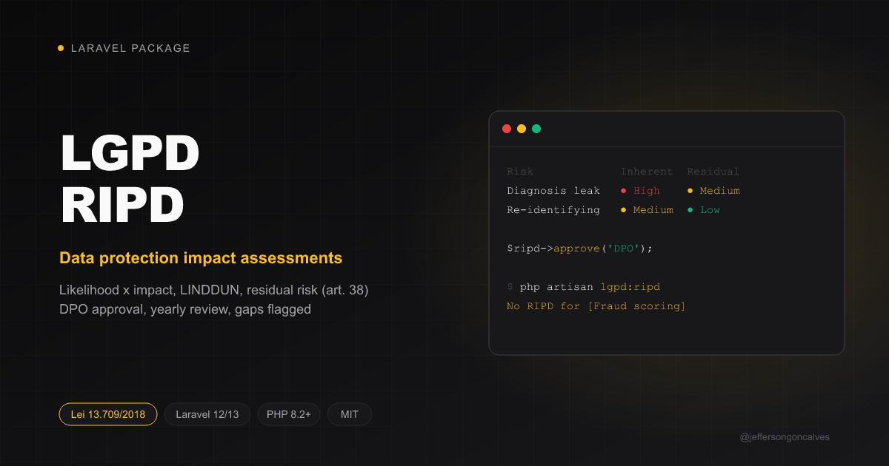

# Laravel LGPD RIPD



[](https://packagist.org/packages/jeffersongoncalves/laravel-lgpd-ripd)
[](https://github.com/jeffersongoncalves/laravel-lgpd-ripd/actions/workflows/tests.yml)
[](https://packagist.org/packages/jeffersongoncalves/laravel-lgpd-ripd)

Data protection impact assessments for the Brazilian General Data Protection Law (LGPD, Lei 13.709/2018). In Portuguese this is the *Relatório de Impacto à Proteção de Dados Pessoais*, or RIPD (arts. 5, XVII and 38). It is part of the [laravel-lgpd](https://github.com/jeffersongoncalves/laravel-lgpd) suite. Each assessment can be linked to a processing activity from [laravel-lgpd-records](https://github.com/jeffersongoncalves/laravel-lgpd-records).

- **Describe the processing:** what it does, the data it collects, and why that data is necessary and proportionate.
- **Score the risks:** each risk gets a likelihood and an impact from 1 to 3, both before and after the mitigation measures. A [LINDDUN](https://linddun.org) threat category is optional.
- **Get the DPO's opinion, then approve:** approving schedules the next review. Editing an approved assessment sends it back to draft.
- **Find the gaps:** see which processing activities with sensitive data, or based on legitimate interest, have no assessment yet. Those are the cases the ANPD is likely to ask about (arts. 10, §3 and 38).

> This package gives you tooling. It does not make you compliant on its own. Your assessments need legal review.

## Installation

```bash
composer require jeffersongoncalves/laravel-lgpd-ripd
php artisan vendor:publish --tag="lgpd-records-migrations"   # if not published yet
php artisan vendor:publish --tag="lgpd-ripd-migrations"
php artisan migrate
```

## Usage

```php
use JeffersonGoncalves\LgpdRipd\Models\ImpactAssessment;

$ripd = ImpactAssessment::create([
    'title' => 'Telemedicine appointments',
    'processing_activity_id' => $telemedicine->id,
    'description' => 'Video appointments; we store the diagnosis and prescriptions.',
    'necessity' => 'Only data needed for the appointment; recordings are not kept.',
    'risks' => [
        [
            'title' => 'Diagnosis leak',
            'threat' => 'data_disclosure',
            'likelihood' => 2, 'impact' => 3,                     // high
            'measures' => 'Encryption at rest, role-based access',
            'residual_likelihood' => 1, 'residual_impact' => 3,   // medium
        ],
    ],
    'dpo_opinion' => 'Acceptable with the listed measures.',
]);

$ripd->scoredRisks();                 // each risk with its level and residual_level
$ripd->highestRisk();                 // RiskLevel::Medium (residual)
$ripd->highestRisk(residual: false);  // RiskLevel::High

$ripd->approve('Ana Souza (DPO)');    // status approved, next_review_at = now + 1 year
$ripd->isReviewDue();
ImpactAssessment::query()->scopes('dueForReview')->get();
```

A risk's level is likelihood × impact: 1–2 is low, 3–4 is medium and 6–9 is high. When you leave out the residual scores, the residual level is the inherent one. You need at least one risk to approve. Changing the title, activity, description, necessity, risks or DPO opinion of an approved assessment sends it back to draft. Approve it again after the review.

Threats (`Threat` enum, LINDDUN): `linking`, `identifying`, `non_repudiation`, `detecting`, `data_disclosure`, `unawareness`, `non_compliance`.

### Which activities need one

```php
use JeffersonGoncalves\LgpdRipd\Facades\LgpdRipd;

LgpdRipd::candidates();
// [['activity' => ProcessingActivity, 'reasons' => ['sensitive_data']], ...]
```

An activity is listed when it has no assessment, and either one of its models declares a `DataCategory::Sensitive` column or its legal basis is legitimate interest. Any other high-risk processing still needs your own judgment: large scale, minors, new technology, automated decisions.

## Report

```bash
php artisan lgpd:ripd          # assessments with inherent/residual risk and next review, then the gaps
php artisan lgpd:ripd --json   # every assessment, ready to hand to the ANPD
```

```php
LgpdRipd::export($ripd);   // one assessment as an array
```

## Testing

```bash
composer test
```

## Changelog

See [CHANGELOG](CHANGELOG.md).

## License

The MIT License (MIT). See [License File](LICENSE.md).
